# Cubrí Seguros · Flujo de contratación digital

Front-end de un checkout de seguros (Seguro de Celular) para el TP5 de **Diseño UXUI 2026 · FCyT**.
El usuario elige un producto, cotiza, elige un plan, carga sus datos, paga (simulado) y recibe su número de póliza.

> **Sitio publicado:** https://TU-SITIO.netlify.app  ← reemplazar por la URL de Netlify
> **Repositorio:** https://github.com/TU_USUARIO/cubri-seguros  ← reemplazar por el link del repo

## Stack

HTML5 · Tailwind CSS v4 (CDN, sin build) · Basecoat UI (solo CSS) · JavaScript vanilla (módulos ES). Sin React, Vue, jQuery ni librerías de validación. Tipografía Inter (Google Fonts).

## Cómo correrlo

No requiere Node ni compilación (opción 3.2 del TP: **sin build, CDN**). Hay que abrirlo con un servidor local, **nunca con doble click** (`file://`), porque `fetch('data/planes.json')` falla con ese protocolo.

```bash
# Opción A: extensión Live Server de VS Code → clic derecho en index.html → "Open with Live Server"
# Opción B: desde la carpeta del proyecto
npx serve
```

Después abrir la URL que indique la consola (`index.html` redirige a `catalogo.html`).

## Estructura

```
cubri-seguros/
├── index.html              ← punto de entrada, redirige al catálogo
├── catalogo.html           ← 01 · Inicio / Catálogo
├── cotizar.html            ← 02 · Cotizar (Paso 1)
├── elegirPlan.html         ← 03 · Elegir plan (Paso 2)
├── datosPersonales.html    ← 04 · Datos personales (Paso 3)
├── pago.html               ← 05 · Pago (Paso 4)
├── confirmacion.html       ← 06 · Éxito
├── errorDePago.html        ← 07 · Error de pago
├── css/
│   ├── tokens.css          ← colores, radio y variables de Basecoat
│   └── componentes.css     ← botón, campo, chip, stepper, cards, layout responsive
├── data/
│   └── planes.json         ← planes y tasas (se carga con fetch)
├── js/
│   ├── app.js              ← arranque, guardia de navegación y carga del controlador de cada página
│   ├── estado.js           ← objeto solicitud + funciones para modificarlo
│   ├── render.js           ← pinta stepper, resumen y campos a partir del estado
│   ├── formulario.js       ← conecta cada formulario con el estado y las validaciones
│   ├── validaciones.js     ← funciones puras: reciben un valor y devuelven error o null
│   ├── cotizador.js        ← calcularCuota() (única función de cálculo) y carga de planes
│   ├── pago.js             ← simularPago() y generarPoliza()
│   └── paginas/            ← un controlador por pantalla (catalogo.js, cotizar.js, ...)
├── capturas/               ← capturas mobile (390) y desktop (1440)
└── README.md
```

## Reglas de negocio implementadas

- **Cuota:** `Math.round(valor × tasaAnual / 12 × factorAntigüedad)`, en una sola función (`calcularCuota`).
  Tasas: Básico 4 %, Plus 6 %, Premium 9 %. Factores: menos de 1 año 1,00 · 1 a 2 años 1,10 · más de 2 años 1,25.
- **Casos de prueba (verificados):**

| Valor | Antigüedad | Básico | Plus | Premium |
|---|---|---|---|---|
| $ 600.000 | Menos de 1 año | $ 2.000 | $ 3.000 | $ 4.500 |
| $ 600.000 | 1 a 2 años | $ 2.200 | $ 3.300 | $ 4.950 |
| $ 1.200.000 | Más de 2 años | $ 5.000 | $ 7.500 | $ 11.250 |

- **Validaciones** en línea al salir del campo (`blur`), botones deshabilitados hasta que todo sea válido, foco al primer campo con error al intentar avanzar, `aria-invalid` + `role="alert"`.
- **Pago simulado (1,5 s):** `4111 1111 1111 1111` → aprobado → pantalla de éxito · `4000 0000 0000 0002` → rechazado → pantalla de error. Cualquier otro número válido se aprueba.
- **Póliza:** formato `POL-AAAA-NNNNNN`.

## Decisiones tomadas

- **Una página HTML por pantalla** (en lugar de un solo `index.html` con `<section data-paso>`), para que el código sea modular. `index.html` solo redirige al catálogo.
- **Un único estado, guardado en `sessionStorage`.** Como cada paso es una página distinta, el objeto `solicitud` se vuelve a leer en cada una. Así "Volver" y "Reintentar pago" conservan todos los datos. Se borra al cerrar la pestaña, y "Volver al inicio" reinicia la solicitud.
- **Guardia de navegación:** si se entra directo a un paso sin los datos anteriores válidos, se redirige al paso que corresponde.
- **Resumen generado una sola vez** (`renderResumen()`): es el mismo elemento en mobile (barra fija sobre el botón en el paso 2, card en el paso 4) y desktop (card lateral de 380 px).
- **Catálogo:** se siguió la captura del Figma (los productos deshabilitados muestran su descripción, y tienen el atributo `title="Próximamente"`).
- **Pago:** se agregó el campo **Titular** de la tarjeta (lo exige la validación del TP) debajo de vencimiento y CVV.
- **Planes:** `data/planes.json` respeta el JSON del TP y suma dos campos opcionales: `noIncluye` (coberturas tachadas de la vista mobile) y `detalleDesktop` (lista de coberturas con ✓ / ✗ tal como se ve en la vista desktop, donde Premium dice "Robo + rotura total").
- **Marcas del select:** el TP no define la lista; se usaron Samsung, Apple, Motorola y Xiaomi.
- **Fecha de nacimiento:** campo de texto `dd/mm/aaaa` (como en el Figma). El TP define un único mensaje de error para este campo y se usa para cualquier valor inválido.
- **Vencimiento de tarjeta:** se considera válida hasta el último día del mes indicado.
- **"Descargar póliza"** genera un archivo de texto con los datos de la póliza (el TP no define esta acción).
- **"Cambiar medio de pago"** vuelve al Paso 4 conservando los datos y dejando el foco en el medio de pago.
- **Logo "Cubrí" e íconos:** no se contaba con los archivos originales, así que se dibujaron en SVG inline respetando la estética del Figma.
- **Barra de estado del teléfono (9:41 · 5G):** es parte del marco del mockup en Figma, no se incluyó en la app.
- **Desktop (1440):** se armó con las vistas D01–D07 del Figma y la sección 8 del TP, con los mismos archivos que mobile (prefijo `lg:` de Tailwind). Checkout en 2 columnas `lg:grid-cols-[1fr_380px]`, planes en fila, "Volver" a la izquierda y "Continuar" a la derecha, inicio con hero a la izquierda y grilla a la derecha. La versión mobile no cambia. Lo que solo existe en desktop:
  - Menú superior (Seguros, Siniestros, Ayuda, Mi cuenta). Son decorativos: el TP no define esas pantallas.
  - Título de cada paso con la línea "Seguro de Celular" arriba, y stepper dentro de una card a todo el ancho.
  - Card de **Resumen** blanca con filas según el paso (paso 1: Seguro, Equipo, Valor; pasos 2 y 3: más Plan y Total mensual; paso 4: más Titular) y la nota "Contratación 100% online · cancelás cuando quieras". Se genera con la misma función `renderResumen()` que usa mobile.
  - Catálogo: etiqueta "Primer mes con 20% OFF" sobre el título, precios "desde" en cada producto, botón "Cotizar ahora" y las tres tarjetas de beneficios (100% online, Póliza al instante, Sin permanencia).
  - Datos personales en 3 columnas ("Fecha de nacimiento") con el texto "Completá los campos con error para continuar" junto al botón deshabilitado.
  - Pago: Titular al lado del número de tarjeta, mostrado en mayúsculas (solo visual, el valor guardado es el que escribió la persona) y aviso de simulación con las dos tarjetas de prueba.
  - Confirmación y error: card centrada, botones lado a lado y fila "Equipo" en el detalle de la póliza.
- **Paso 1 en desktop:** no lleva botón "Volver", como en el Figma (en mobile se vuelve con la flecha del encabezado).

## Mapeo del diseño a componentes

Del Figma ("Mapeo de la UI a componentes shadcn/ui") a su equivalente sin React con Basecoat UI y Tailwind:

| Elemento del diseño | shadcn/ui | Cómo se resolvió | Dónde aparece |
|---|---|---|---|
| Button (Primary / Secondary / Ghost / Disabled) | Button · default / outline / ghost / disabled | `<button class="btn">` con `data-variant` | Todas las pantallas |
| Input (Default / Focus / Error) | Input + Label + FormMessage | `.field` con `<label>`, `<input>` y `<p role="alert">` (`aria-invalid` en error) | Cotizar, Datos, Pago |
| Input Select | Select | `<select>` nativo dentro de `.field` | Cotizar · Marca |
| Chips de antigüedad | ToggleGroup (single) | `<input type="radio">` + `<label>` con el mismo `name` | Cotizar |
| Plan cards con radio | RadioGroup + Card | `<label class="card">` que envuelve el radio, `name="plan"` | Elegir plan |
| Medio de pago | RadioGroup | Dos `<label>` con radio, `name="metodo"` | Pago |
| Badge "Recomendado" / "20% OFF" | Badge | `<span class="badge">` | Inicio, Plan |
| Resumen lateral | Card + Separator | `<aside class="card">` generado por `renderResumen()` | Pasos 1 a 4 (desktop) |
| Aviso de simulación | Alert | `<div class="alert">` | Pago, Error |
| Checkbox de términos | Checkbox | `<input type="checkbox">` dentro de `.field` | Datos |
| Stepper | No existe: se arma a mano | `renderStepper()` + Tailwind/CSS propio, 3 estados | Pasos 1 a 4 |
| Pago procesando (bonus) | Spinner + Sonner (toast) | Spinner SVG en el botón; el toast no se implementó | Pago |

## Capturas

| Pantalla | Mobile (390) | Desktop (1440) |
|---|---|---|
| 01 · Inicio / Catálogo | 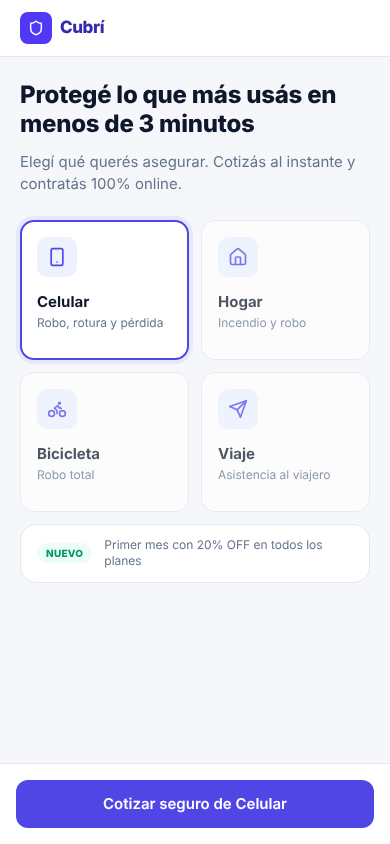 | 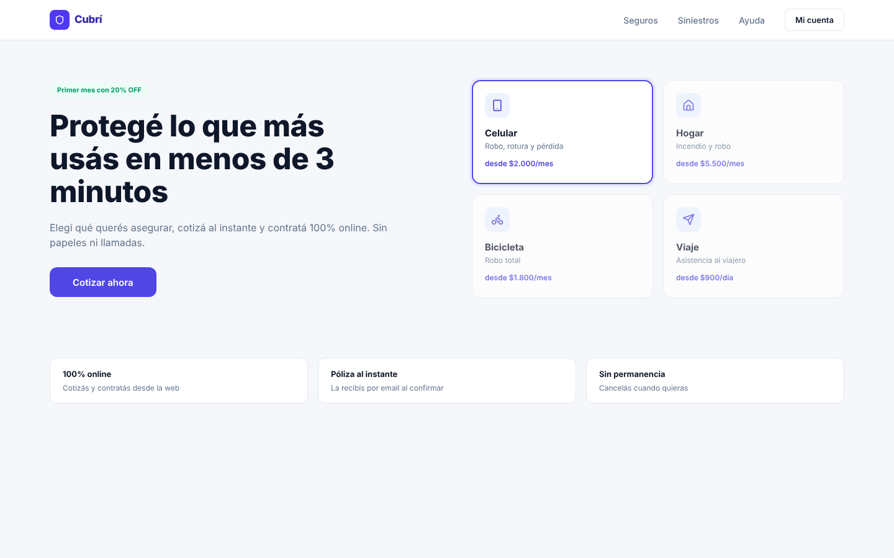 |
| 02 · Cotizar | 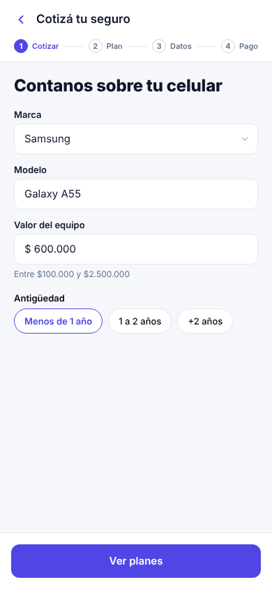 | 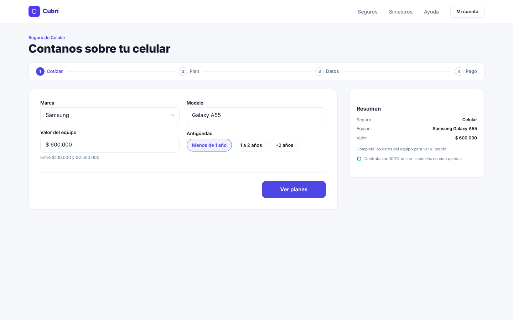 |
| 03 · Elegir plan | 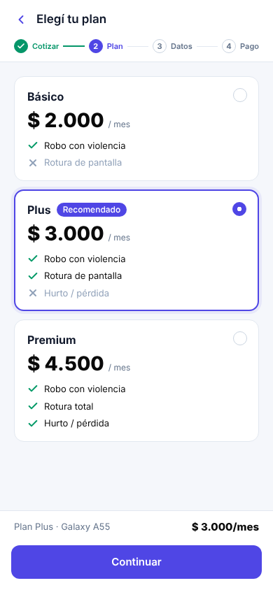 | 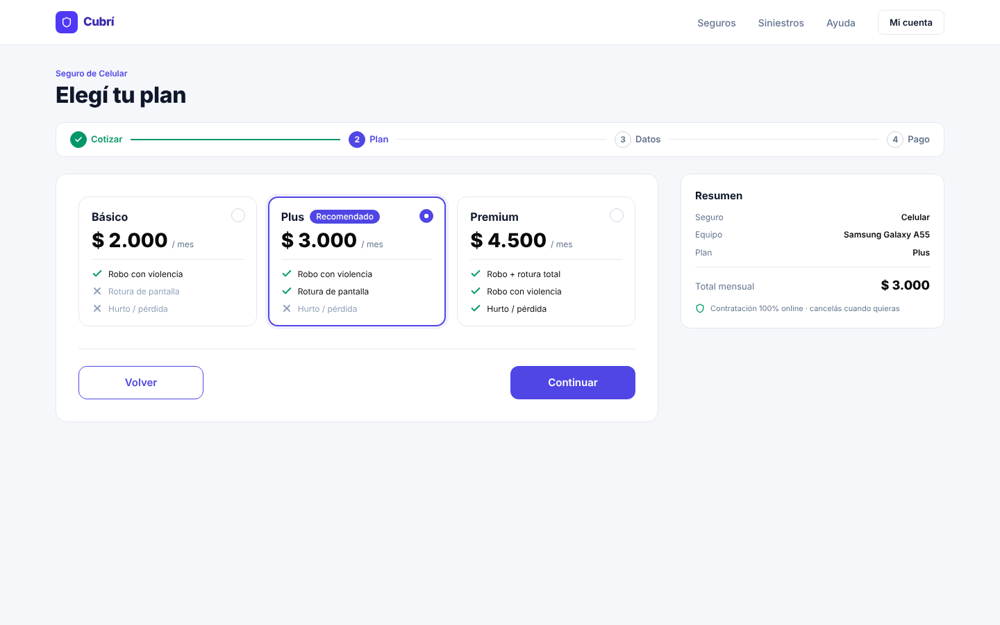 |
| 04 · Datos personales | 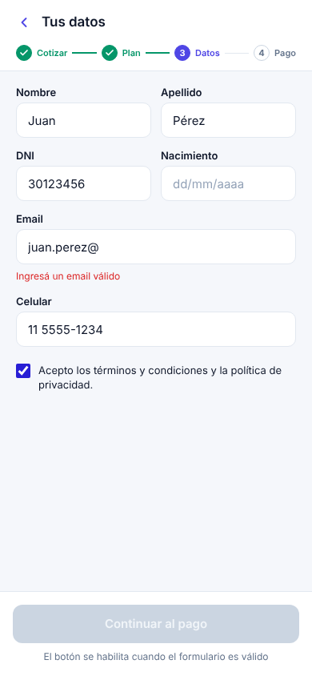 | 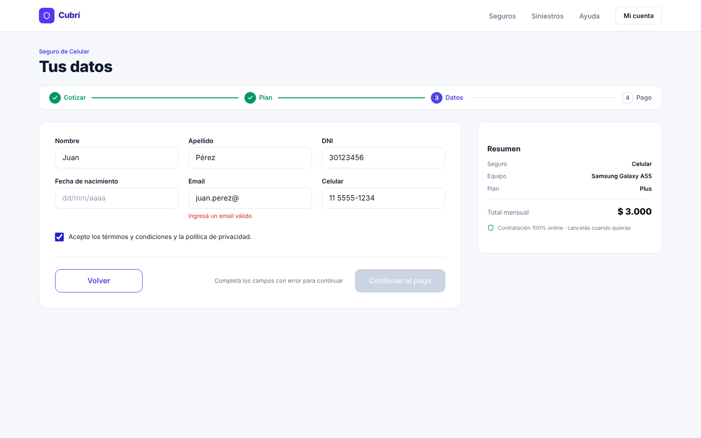 |
| 05 · Pago | 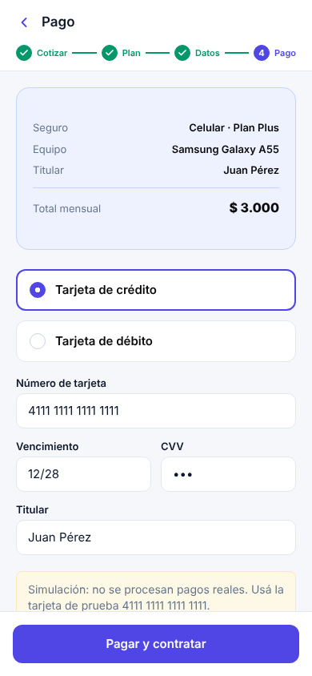 | 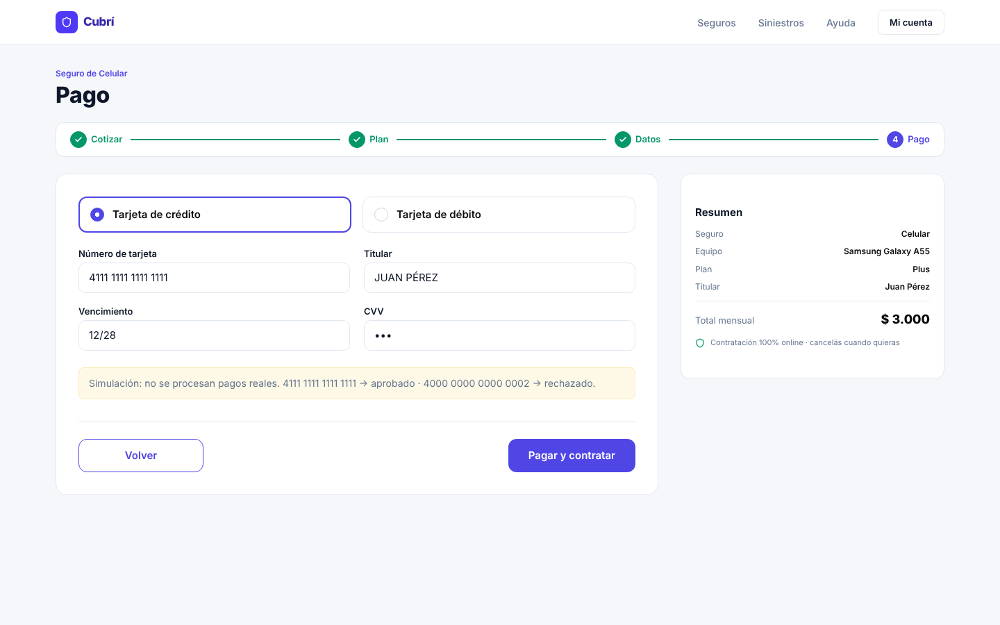 |
| 06 · Confirmación | 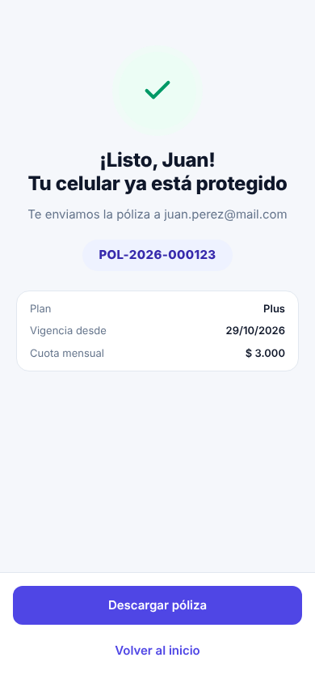 | 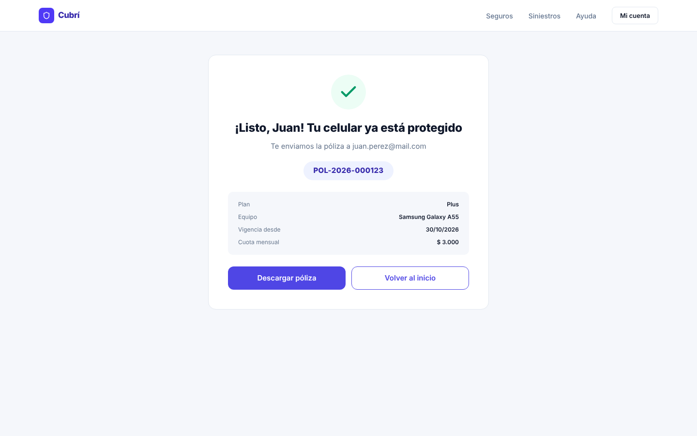 |
| 07 · Error de pago | 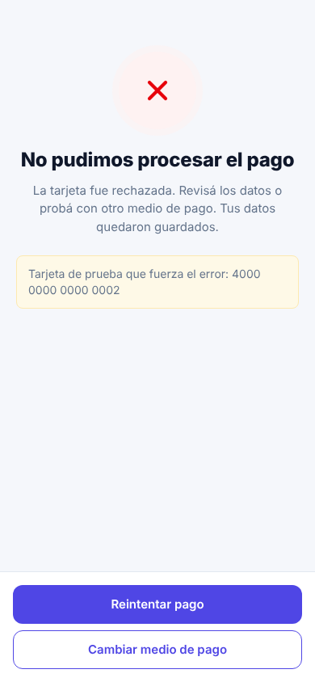 | 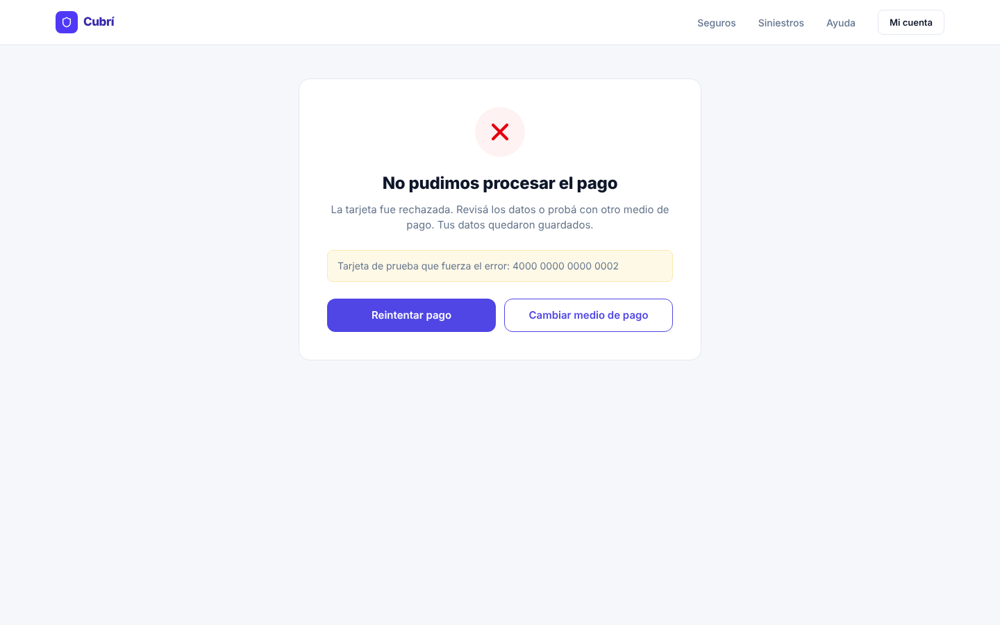 |

## Bonus

- **Máscaras de input:** número de tarjeta en grupos de 4 y vencimiento con barra automática (MM/AA).

## Checklist de entrega

- [x] Las 7 pantallas existen y se ven bien en 390 px y 1440 px.
- [x] Los 3 casos de prueba de cuota dan exactamente el valor esperado.
- [x] No se puede avanzar con datos inválidos y cada error tiene su mensaje.
- [x] "Volver" conserva los datos en todos los pasos.
- [x] La tarjeta 4000 0000 0000 0002 lleva al error y "Reintentar" vuelve al pago con todo cargado.
- [x] La póliza tiene formato POL-AAAA-NNNNNN.
- [x] Sin errores en la consola del navegador.
- [ ] Sitio publicado y URL cargada arriba.
